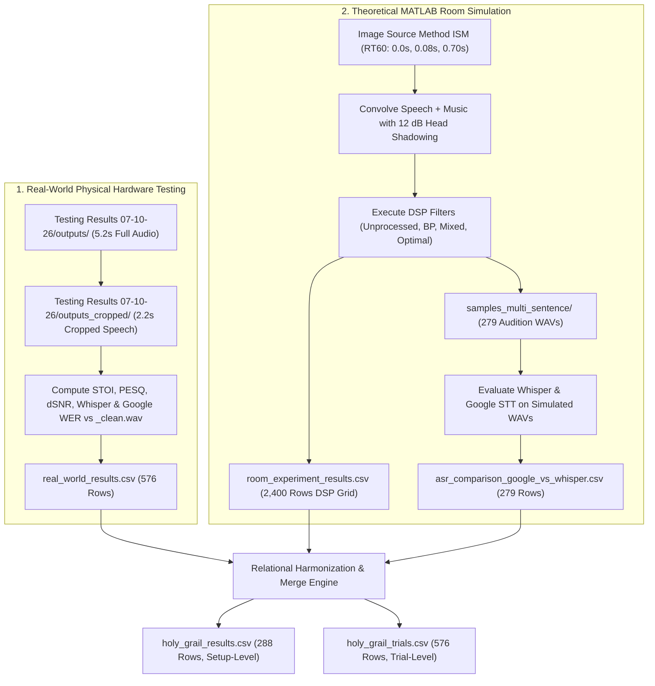

# Holy Grail Reconstruction Guide: End-to-End Logic & Data Sources

This document is an exhaustive engineering guide for an autonomous agent or researcher to reconstruct the **Holy Grail** benchmark datasets (`holy_grail_results.csv` and `holy_grail_trials.csv`) from first principles, **without relying on existing Python build scripts**.

It details:
1. The exact experiments conducted and how they relate.
2. What files currently exist in the repository and what data they contain.
3. The exact algorithms, equations, and parsing logic needed to compute each metric from raw audio.
4. The relational harmonization rules and schemas required to assemble the final unified tables.

---

## 1. Experimental Overview & Architecture

The Holy Grail dataset resolves the divergence between **ideal theoretical simulation** and **physical hardware acoustic reality** by aligning them into a single 1-to-1 benchmark across 288 experimental conditions.



---

## 2. Repository Inventory: Where Existing Data Lives

### 2.1 Real-World Hardware Audio & Datasets

| Path | Format | Description / Contents |
| :--- | :---: | :--- |
| `Testing Results 07-10-26/outputs/` | Directory of WAVs | **576 full raw recordings** (5.2 seconds each). Contains music pre-roll intro, speaker countdown, speech utterance, and musical decay. |
| `Testing Results 07-10-26/outputs_cropped/` | Directory of WAVs | **576 cropped speech WAVs** (2.2 seconds each) plus matching reference files (`*_clean.wav`). Strictly restricted to the talker's speech duration, perfectly aligned sample-by-sample for metric scoring. |
| `NLMS/output_audio/real_world_experiment/real_world_results.csv` | CSV (576 rows) | **Authoritative pre-computed real-world trials**. Contains STOI, Delta STOI, PESQ, Delta SNR, Delta ASL, Whisper WER & Recall, Google STT WER & Recall across all 576 trials. |

### 2.2 Theoretical Simulation Audio & Datasets

| Path | Format | Description / Contents |
| :--- | :---: | :--- |
| `NLMS/tests/run_concert_venue_room_experiment.m` | MATLAB script | Generates room impulse responses using ISM and simulates the complete 2,400-trial room acoustic grid across 5 RT60 conditions. |
| `NLMS/tests/generate_multi_sentence_stt_samples.m` | MATLAB script | Synthesizes multi-sentence audition audio files for speech recognition benchmarking in club room acoustics ($RT_{60} = 0.70\text{ s}$). |
| `dataset/metadata/venue_rirs.mat` | MATLAB `.mat` | Precomputed Image Source Method impulse responses for `freefield`, `damped`, `club`, `arena`, and `stadium`. |
| `dataset/metadata/filter_comparison_workspace.mat` | MATLAB `.mat` | Precomputed coefficient taps for FIR bandpass genre filters and multi-peak notch filter biquads. |
| `NLMS/output_audio/room_experiment/samples_multi_sentence/` | Directory of WAVs | **279 simulated output audio files** evaluated across genres, SNRs, and filter topologies. |
| `NLMS/output_audio/room_experiment/room_experiment_results.csv` | CSV (2,400 rows) | **Authoritative simulation DSP results**. Contains STOI, PESQ, ViSQOL, Delta SNR, and Delta ASL across 5 venues, 3 genres, 4 SNRs, 2 speakers, and 8 filter topologies. |

### 2.3 Simulation Speech Recognition (ASR) Datasets

| Path | Format | Description / Contents |
| :--- | :---: | :--- |
| `NLMS/output_audio/room_experiment/asr_comparison_google_vs_whisper.csv` | CSV (279 rows) | **Joint trial-level ASR evaluation**. Contains side-by-side Whisper WER/Recall and Google STT WER/Recall, status, logprob, confidence, and actual response strings for every file in `samples_multi_sentence/`. |
| `NLMS/output_audio/room_experiment/faster_whisper_multi_sentence_results.csv` | CSV (279 rows) | Individual Faster-Whisper trial metrics on simulated audio. |
| `NLMS/output_audio/room_experiment/faster_whisper_multi_sentence_summary.csv` | CSV (93 rows) | Aggregated mean WER and word recall per condition (Genre $\times$ SNR $\times$ Filter Stage) across all Harvard sentences. |
| `NLMS/output_audio/room_experiment/google_stt_multi_sentence_summary.csv` | CSV (93 rows) | Aggregated mean Google Cloud STT WER and recall per condition. |

### 2.4 Speech Corpus & Musical Stems

| Path | Format | Description / Contents |
| :--- | :---: | :--- |
| `dataset/speech_corpus/male/male_01_IUS-M00201.wav` | Audio (16 kHz mono) | Male talker corpus (`SP1` / Harvard sentence 1). |
| `dataset/speech_corpus/female/female_01_IUS-F00202.wav` | Audio (16 kHz mono) | Female talker corpus (`SP2` / Harvard sentence 1: *"The bill was paid every third week"*). |
| `dataset/speech_corpus/male/male_02_IUS-M02201.wav` | Audio (16 kHz mono) | Male talker corpus (`SP1` / Harvard sentence 2: *"Glue the sheet to the dark blue background"*). |
| `dataset/wav_16k/jazz/` | Directory of WAVs | Clean uncompressed 16 kHz jazz tracks (`jazz_01`, `jazz_02`). |
| `dataset/wav_16k/rock/` | Directory of WAVs | Clean uncompressed 16 kHz rock tracks (`rock_01`, `rock_02`). |
| `dataset/wav_16k/techno/` | Directory of WAVs | Clean uncompressed 16 kHz techno tracks (`techno_01`, `techno_02`). |

---

## 3. Metric Calculation Logic (From Raw Audio)

If reconstructing directly from raw audio files rather than pre-computed CSVs, use the following mathematical formulations:

### 3.1 Real-World Filename Parsing Logic
Real-world audio files in `Testing Results 07-10-26/outputs_cropped/` follow the format:
```text
[Venue]_[Pos]_[Filter]_[PreConv]_[SNR]_[Song]_[Speaker].wav
```
Example: `Outside_Pos1_PASSTHROUGH_PreConvON_SNR0_rock2_SP1.wav`
* **`Venue`**: `Full_Outside`, `Outside`, `Indoors` (note: map `Indoors` to standard `Inside`).
* **`Pos`**: Microphone position index (e.g., `Pos1`). Ignore for setup grouping.
* **`Filter`**: `PASSTHROUGH`, `CONTROL`, `MIXED`, `OPTIMAL`.
* **`PreConv`**: Hardware calibration flag. Ignore for setup grouping.
* **`SNR`**: Prefix `SNR` followed by integer: `SNR-20` $\rightarrow -20\text{ dB}$, `SNR0` $\rightarrow 0\text{ dB}$.
* **`Song`**: Musical track stem: `jazz1`, `jazz2`, `rock1`, `rock2`, `techno1`, `techno2`.
  * The musical genre is the prefix of the song name (`jazz`, `rock`, `techno`).
* **`Speaker`**: `SP1` (male talker) or `SP2` (female talker).
* Matching Clean Reference: Replace file extension with `_clean.wav` (e.g., `Outside_Pos1_PASSTHROUGH_PreConvON_SNR0_rock2_SP1_clean.wav`).

### 3.2 Short-Time Objective Intelligibility (STOI & Delta STOI)
* Compute STOI between the cropped output $y[n]$ and the time-aligned reference $s[n]$:
  $$\text{STOI} = \text{stoi}(s[n], y[n], f_s=16000, \text{extended}=\text{False})$$
  STOI ranges from $0.0$ (completely unintelligible) to $1.0$ (perfect intelligibility).
* Compute **Delta STOI** relative to the unprocessed baseline for that exact same trial condition:
  $$\Delta\text{STOI} = \text{STOI}_{\text{filtered}} - \text{STOI}_{\text{PASSTHROUGH}}$$

### 3.3 Perceptual Evaluation of Speech Quality (PESQ)
* Compute ITU-T P.862.2 wideband PESQ score:
  $$\text{PESQ} = \text{pesq}(f_s=16000, s[n], y[n], \text{'wb'})$$
  PESQ ranges from $1.0$ (lowest quality) to $4.5$ (broadcast speech quality).

### 3.4 Delta SNR ($\Delta\text{SNR}$)
* In real-world cropped audio, calculate speech active energy and residual musical energy using the time-aligned clean reference as a voice-activity mask ($V[n] \in \{0, 1\}$):
  $$P_{\text{speech, active}} = \frac{1}{\sum V[n]} \sum_{n} (y[n] - s[n])^2 \cdot V[n]$$
  $$P_{\text{noise, silent}} = \frac{1}{\sum (1 - V[n])} \sum_{n} y[n]^2 \cdot (1 - V[n])$$
  $$\text{SNR}_{\text{out}} = 10 \log_{10} \left( \frac{P_{\text{clean}}}{P_{\text{residual noise}}} \right)$$
  $$\Delta\text{SNR}_{\text{dB}} = \text{SNR}_{\text{out}} - \text{SNR}_{\text{in}}$$
* In simulation, $\Delta\text{SNR}$ is computed analytically using the separated filtered speech array $y_s[n]$ and filtered noise array $y_n[n]$:
  $$\Delta\text{SNR}_{\text{sim}} = 10 \log_{10}\left(\frac{\sum y_s[n]^2}{\sum y_n[n]^2}\right) - \text{SNR}_{\text{nominal}}$$

### 3.5 Speech Recognition (ASR) Word Error Rate & Recall
1. **Engine Configurations**:
   * **Faster-Whisper**: Model `small.en`, compute type `int8`, beam size $5$, temperature $0.0$, VAD filter enabled.
   * **Google Cloud STT**: Speech-to-Text API v1, language `en-US`, encoding `LINEAR16`, sample rate $16000$.
2. **Text Normalization**:
   * Lowercase string, strip all punctuation (`.,?!'"`), normalize whitespace.
3. **Word Error Rate (WER %)**:
   * Computed via word-level Levenshtein edit distance:
     $$\text{WER} = \frac{S + D + I}{N_{\text{ref}}} \times 100\%$$
     Where $S$ is substitutions, $D$ is deletions, $I$ is insertions, and $N_{\text{ref}}$ is total reference words.
4. **Word Recall (%)**:
   $$\text{Recall} = \frac{N_{\text{ref}} - S - D}{N_{\text{ref}}} \times 100\% = \frac{\text{Correct Words}}{N_{\text{ref}}} \times 100\%$$

> [!WARNING]
> **The $-20\text{ dB}$ Whisper Hallucination Trap**:
> At $-20\text{ dB}$ SNR, noise is $100\times$ stronger than speech. Faster-Whisper frequently transcribes YouTube closing subtitles (*"thank you for watching"* or *"bye"*). These insertions inflate WER above $100\%$. This is mathematically correct according to the standard Levenshtein formula ($(S+D+I)/N > 1.0$) and reflects total ASR failure under extreme noise, not an engineering bug.

---

## 4. Harmonization Mappings & Dictionaries

To combine simulation and real-world results, use the following exact mappings:

### 4.1 Venue Mapping (1-to-1 Acoustic Coupling)
| Simulation Venue (`room_experiment_results.csv`) | Real-World Venue (`real_world_results.csv`) | Holy Grail Unified Key (`Venue`) | Acoustic Physics |
| :--- | :--- | :--- | :--- |
| `freefield` | `Full_Outside` | **`Full_Outside`** | Open air, $RT_{60} = 0.00\text{ s}$ |
| `damped` | `Outside` | **`Outside`** | Semi-enclosed patio, $RT_{60} = 0.08\text{ s}$ |
| `club` | `Inside` / `Indoors` | **`Inside`** | Reverberant room, $RT_{60} = 0.70\text{ s}$ |

*(Note: Simulation venues `arena` and `stadium` do not have physical hardware counterparts and must be excluded from the Holy Grail join).*

### 4.2 Speech Corpus Mapping
| Simulation File / Sentence ID | Real-World Code | Holy Grail Key (`Speech_Corpus`) | Talker & Text |
| :--- | :--- | :--- | :--- |
| `male_01_IUS-M00201.wav` / `sent02` | `SP1` | **`SP1`** | Male talker (*"Glue the sheet to the dark blue background"*) |
| `female_01_IUS-F00202.wav` / `sent01`| `SP2` | **`SP2`** | Female talker (*"The bill was paid every third week"*) |

### 4.3 Filter Topology Mapping
| Simulation Label (`Filter`) | Simulation Stage (`Filter_Stage`) | Real-World Label | Holy Grail Key (`Filter`) | Architecture Description |
| :--- | :--- | :--- | :--- | :--- |
| `Unprocessed` | `primary_noisy` | `PASSTHROUGH` | **`PASSTHROUGH`** | Raw microphone signal |
| `FIR_BP` | `fir_bp` | `CONTROL` | **`CONTROL`** | Fixed genre bandpass filter ($60 - 300\text{ Hz}$) |
| `Cascade_Notch_NLMS` | `cascade_notch_nlms` | `MIXED` | **`MIXED`** | Multi-peak notch + Leaky NLMS |
| `Cascade_Hybrid_Optimal` | `hybrid_optimal` | `OPTIMAL` | **`OPTIMAL`** | Multi-peak notch + Soft VAD + Leaky NLMS |

---

## 5. Reconstructing the Tables: Step-by-Step Relational Logic

### 5.1 Reconstructing the Setup-Level Table (`holy_grail_results.csv` - 288 Rows)

1. **Filter Simulation DSP Data**:
   * Load `room_experiment_results.csv`.
   * Filter where `Venue` in `['freefield', 'damped', 'club']`, `File` in `['male_01...', 'female_01...']`, `SNR_dB` in `[-20, -15, -10, 0]`, and `Filter` in `['Unprocessed', 'FIR_BP', 'Cascade_Notch_NLMS', 'Cascade_Hybrid_Optimal']`.
   * Map `Venue`, `File` $\rightarrow$ `Speech_Corpus`, and `Filter` using Section 4 mappings.
   * Compute `Sim_Delta_STOI` by subtracting each setup's `Sim_STOI` from its matching `PASSTHROUGH` `Sim_STOI`.
   * Rename columns: `STOI` $\rightarrow$ `Sim_STOI`, `PESQ` $\rightarrow$ `Sim_PESQ`, `ViSQOL` $\rightarrow$ `Sim_ViSQOL`, `dSNR_dB` $\rightarrow$ `Sim_Delta_SNR_dB`, `dASL_dB` $\rightarrow$ `Sim_Delta_ASL_dB`.

2. **Aggregate Real-World Trials**:
   * Load `real_world_results.csv` (576 rows).
   * Group by `['Venue', 'Genre', 'SNR_dB', 'Speaker', 'Filter_Name']`.
   * Compute the mean across trials (averaging over `song1` and `song2`) for:
     `STOI`, `Delta_STOI`, `PESQ`, `Delta_SNR_dB`, `Delta_ASL_dB`, `Whisper_WER`, `Whisper_Recall`, `Google_WER`, `Google_Recall`.
   * Rename `Speaker` $\rightarrow$ `Speech_Corpus`, `Filter_Name` $\rightarrow$ `Filter`, prefixing real metrics with `Real_`.

3. **Extract Exact Simulation ASR Trials**:
   * Load `asr_comparison_google_vs_whisper.csv`.
   * Filter where `Sentence_ID` in `['sent01', 'sent02']`.
   * Map `sent01` $\rightarrow$ `SP2`, `sent02` $\rightarrow$ `SP1`.
   * Map `Filter_Stage` to standard `Filter` labels.
   * Set `Venue = 'Inside'`.
   * Extract: `Sim_Whisper_WER_Pct`, `Sim_Whisper_Recall_Pct`, `Sim_Whisper_Transcript`, `Sim_Google_WER_Pct`, `Sim_Google_Recall_Pct`, `Sim_Google_Transcript`.

4. **Extract Simulation Condition ASR Aggregates**:
   * Load `faster_whisper_multi_sentence_summary.csv`.
   * Map `Filter_Stage` to standard `Filter` labels.
   * Extract `Sim_Condition_Mean_WER_Pct` and `Sim_Condition_Mean_Recall_Pct` keyed on `['Genre', 'SNR_dB', 'Filter']`.

5. **Merge Datasets**:
   * Execute an **Inner Join** between Aggregated Real Data and Filtered Simulation DSP Data on:
     `['Venue', 'Genre', 'SNR_dB', 'Speech_Corpus', 'Filter']`.
     *(Result: Exactly 288 rows)*.
   * Left Join exact simulation ASR trials on the 5 setup keys.
   * Left Join condition-level simulation ASR summaries on `['Genre', 'SNR_dB', 'Filter']`.
   * Export to [`holy_grail_results.csv`](file:///Users/macairm1/Documents/antigravity/blissful-bose/NLMS/output_audio/holy_grail_results.csv).

---

### 5.2 Reconstructing the Trial-Level Table (`holy_grail_trials.csv` - 576 Rows)

1. Load `real_world_results.csv` without grouping, retaining individual track stems (`Song` = `rock1`, `rock2`, etc.) and transcripts (`Real_Whisper_Transcript`, `Real_Google_Transcript`).
2. Inner Join simulation DSP baseline metrics on `['Venue', 'Genre', 'SNR_dB', 'Speech_Corpus', 'Filter']`.
3. Left Join exact simulation ASR metrics and condition aggregates.
4. Export to [`holy_grail_trials.csv`](file:///Users/macairm1/Documents/antigravity/blissful-bose/NLMS/output_audio/holy_grail_trials.csv) (576 rows).

---

## 6. Target Schema Definitions

### 6.1 `holy_grail_results.csv` Schema (288 Rows $\times$ 28 Columns)

| Column Name | Type | Range / Example | Nullability | Description |
| :--- | :---: | :---: | :---: | :--- |
| `Venue` | string | `Full_Outside`, `Outside`, `Inside` | Non-null | Unified acoustic venue |
| `Genre` | string | `jazz`, `rock`, `techno` | Non-null | Music genre |
| `SNR_dB` | integer | `-20, -15, -10, 0` | Non-null | Signal-to-Noise Ratio (dB) |
| `Speech_Corpus` | string | `SP1`, `SP2` | Non-null | Talker ID (`SP1`=Male, `SP2`=Female) |
| `Filter` | string | `PASSTHROUGH`, `CONTROL`, `MIXED`, `OPTIMAL` | Non-null | Filter topology |
| `Real_STOI` | float | $[0.30, 0.95]$ | Non-null | Real-world objective intelligibility |
| `Sim_STOI` | float | $[0.15, 0.90]$ | Non-null | Simulated objective intelligibility |
| `Real_Delta_STOI` | float | $[-0.30, +0.35]$ | Non-null | Real STOI gain over `PASSTHROUGH` |
| `Sim_Delta_STOI` | float | $[-0.25, +0.40]$ | Non-null | Sim STOI gain over `PASSTHROUGH` |
| `Real_Delta_SNR_dB` | float | $[-12.0, +16.0]$ | Non-null | Real noise reduction in dB |
| `Sim_Delta_SNR_dB` | float | $[-10.0, +18.0]$ | Non-null | Sim noise reduction in dB |
| `Real_PESQ` | float | $[1.00, 3.50]$ | Non-null | Real ITU-T P.862.2 score |
| `Sim_PESQ` | float | $[1.00, 3.80]$ | Non-null | Sim ITU-T P.862.2 score |
| `Sim_ViSQOL` | float | $[1.00, 4.50]$ | Non-null | Sim ViSQOL MOS score |
| `Real_Delta_ASL_dB` | float | $[-8.0, +4.0]$ | Non-null | Real Active Speech Level attenuation |
| `Sim_Delta_ASL_dB` | float | $[-6.0, +3.0]$ | Non-null | Sim Active Speech Level attenuation |
| `Real_Whisper_WER_Pct`| float | $[0.0, 100.0]$ | Non-null | Real Faster-Whisper Word Error Rate % |
| `Sim_Whisper_WER_Pct` | float | $[0.0, 300.0]$ | Null for non-club | Simulated Faster-Whisper WER % |
| `Real_Whisper_Recall_Pct`| float | $[0.0, 100.0]$ | Non-null | Real Faster-Whisper Word Recall % |
| `Sim_Whisper_Recall_Pct` | float | $[0.0, 100.0]$ | Null for non-club | Simulated Faster-Whisper Recall % |
| `Real_Google_WER_Pct` | float | $[0.0, 100.0]$ | Null for $\le -15\text{ dB}$ | Real Google Cloud STT WER % |
| `Sim_Google_WER_Pct`  | float | $[0.0, 100.0]$ | Null for non-club | Simulated Google Cloud STT WER % |
| `Real_Google_Recall_Pct`| float | $[0.0, 100.0]$ | Null for $\le -15\text{ dB}$ | Real Google Cloud STT Recall % |
| `Sim_Google_Recall_Pct` | float | $[0.0, 100.0]$ | Null for non-club | Simulated Google Cloud STT Recall % |
| `Sim_Whisper_Transcript`| string| Text string | Null for non-club | Exact Whisper response on sim audio |
| `Sim_Google_Transcript` | string| Text string | Null for non-club | Exact Google STT response on sim audio |
| `Sim_Condition_Mean_WER_Pct`| float | $[0.0, 250.0]$ | Non-null (except $-20\text{ dB}$ mixed/opt)| Average sim WER across all sentences |
| `Sim_Condition_Mean_Recall_Pct`| float | $[0.0, 100.0]$ | Non-null (except $-20\text{ dB}$ mixed/opt)| Average sim recall across sentences |

---

## 7. Sanity Check Rules for Validation

Before declaring the reconstructed dataset valid, run the following automated assertions:

1. **Row Count Check**:
   * Setup-level table MUST contain exactly **288 rows**.
   * Trial-level table MUST contain exactly **576 rows**.
2. **Completeness of Core DSP Metrics**:
   * `Real_STOI`, `Sim_STOI`, `Real_Delta_STOI`, `Sim_Delta_STOI`, `Real_Delta_SNR_dB`, and `Sim_Delta_SNR_dB` MUST have **0 null values**.
3. **0 dB SNR Sanity Invariants**:
   * For `Inside`, `techno`, `SNR_dB = 0`, `Filter = MIXED`:
     * `Real_Whisper_WER_Pct == 0.0%`
     * `Sim_Whisper_WER_Pct == 0.0%`
     * `Sim_Whisper_Transcript == "the bill was paid every third week"` (for `SP2`)
     * `Sim_Whisper_Transcript == "glue the sheet to the dark blue background"` (for `SP1`)
4. **Intelligibility Invariant**:
   * `CONTROL` (fixed bandpass) must exhibit inferior WER compared to `OPTIMAL` across both environments due to high-frequency consonant clipping above $300\text{ Hz}$.
